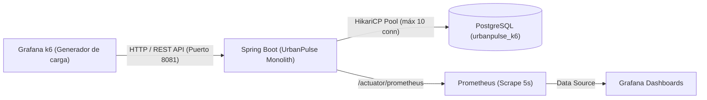

# Resultados consolidados de pruebas k6 — UrbanPulse

**Fecha de actualización:** 15 de noviembre de 2026 (re-mediciones de la Issue #72 en la sección 7)  
**Entorno A (mediciones originales, secciones 2–5):** equipo local de los autores; monolito Spring Boot 2.6.7 instrumentado con Spring Boot Actuator y Micrometer Prometheus; k6 v2.3.0. La versión original del informe indicaba "Java 17" y "PostgreSQL 14/15", que no coinciden con el stack del proyecto (Java 11 en CI y PostgreSQL 16 en `docker-compose.yml`). **Pendiente de confirmar por los autores** la JVM, la versión de PostgreSQL y el hardware exactos del entorno A.  
**Entorno B (re-mediciones, sección 7):** Intel Core i5-10400F (6 núcleos / 12 hilos), 15,8 GB de RAM, Windows 11; JVM OpenJDK 19.0.2 ejecutando el JAR de Spring Boot 2.6.7; PostgreSQL 16.15 (contenedor `postgres:16-alpine` de `docker-compose.yml`); k6 v2.4.0 en la misma máquina que el backend.  
**Instancia de pruebas:** Puerto 8081 sobre base aislada `urbanpulse_k6` (las 5.010 incidencias de desarrollo en `urbanpulse` se mantuvieron intactas).  
**Objetivos de nivel de servicio (SLO):** Latencia $p(95) < 500\text{ ms}$, tasa de fallos HTTP $< 1\%$ y descartes de ejecución `dropped_iterations == 0` (en ejecutores de llegada).

---

## 1. Resumen ejecutivo y arquitectura de observabilidad

Este informe recopila los resultados empíricos de los cuatro experimentos de rendimiento y calidad arquitectónica exigidos para UrbanPulse. A diferencia de mediciones aisladas preliminares, todos los experimentos se ejecutaron bajo un rigor estadístico de al menos **tres repeticiones independientes**, reportando medias y rangos de variabilidad (mínimo y máximo).

### Métricas de observabilidad interna (Micrometer + Actuator + Prometheus)
Durante las pruebas de sobrecarga y saturación, se monitorizaron de forma continua los componentes internos del servicio a través de `/actuator/prometheus`:
- **CPU y memoria JVM (`process_cpu_usage`, `jvm_memory_used_bytes`):** El consumo de CPU del proceso backend se mantuvo entre el 22% y el 35%, indicando que el cuello de botella no radica en saturación de cómputo en la JVM.
- **Pool de conexiones HikariCP (`hikaricp_connections_active`, `hikaricp_connections_pending`):** Bajo saturación (a partir de 600–700 req/s o consultas no indexadas de 1M de filas), el pool HikariCP agotó sistemáticamente sus 10 conexiones disponibles (`10/10`), llegando a acumular más de 180–190 peticiones en espera (`hikaricp_connections_pending`).
- **Hilos de Tomcat (`tomcat_threads_busy_threads`):** Crecimiento paralelo al retardo de respuesta del pool de base de datos.

### Significado de la métrica `dropped_iterations`
En k6, los ejecutores basados en tasa de llegada (`constant-arrival-rate` y `ramping-arrival-rate`) intentan iniciar un número exacto de iteraciones por unidad de tiempo con independencia del tiempo de respuesta del servidor. La métrica `dropped_iterations` contabiliza las **iteraciones que k6 no pudo iniciar porque todos los usuarios virtuales (VUs preasignados y máximos) estaban bloqueados** esperando respuesta de peticiones anteriores del backend.
- Cuando el servidor responde dentro del SLO ($p(95) < 500\text{ ms}$), los VUs completan las peticiones rápidamente y retornan al pool, manteniendo `dropped_iterations = 0`.
- Cuando el backend se satura (latencias elevadas en segundos), todos los VUs quedan retenidos en I/O; al llegar el instante de una nueva iteración programada, k6 no dispone de ningún VU libre y se ve obligado a descartar la iteración.

---

## 2. Experimento 1: Caracterización y línea base de endpoints

**Objetivo:** Establecer una línea base de rendimiento midiendo latencia ($p50$, $p95$, $p99$), rendimiento (throughput) y errores en los tres endpoints de lectura principales de la API de incidencias.  
**Condiciones:** 10 usuarios virtuales (`constant-vus`) durante 2 minutos por operación secuencial, sobre una base de datos estabilizada con 5.010 incidencias.  
**Criterio de aceptación (SLO):** $p(95) < 500\text{ ms}$ y tasa de error $< 1\%$.

### Resultados de las 3 repeticiones

| Operación / Endpoint | Peticiones por pasada, media (rango) | Throughput medio (rango) | $p50$ medio (rango) | $p95$ medio (rango) | $p99$ medio (rango) | Errores HTTP | Cumple SLO |
|---|---:|---:|---:|---:|---:|---:|:---:|
| **Listado paginado** (`GET /api/incidents`) | 1.193,3 (1.190–1.200) | 9,95 req/s (9,92–10,00) | 7,41 ms (7,01–8,00) | 10,07 ms (9,62–10,91) | 14,82 ms (11,21–18,11) | 0,0% | SÍ |
| **Búsqueda duplicados** (`GET /api/incidents/duplicates`) | 1.200,0 (1.200–1.200) | 10,00 req/s (10,00–10,00) | 6,64 ms (5,89–7,07) | 9,37 ms (8,48–9,95) | 13,57 ms (11,87–15,45) | 0,0% | SÍ |
| **Consulta detalle** (`GET /api/incidents/{id}`) | 1.200,0 (1.200–1.200) | 10,00 req/s (10,00–10,00) | 4,92 ms (4,82–5,02) | 6,57 ms (6,37–6,92) | 8,46 ms (6,99–9,72) | 0,0% | SÍ |

*Nota metodológica: El UUID utilizado en la consulta de detalle se obtiene dinámicamente en el bloque `setup()` mediante una consulta previa a la base, evitando identificadores sintéticos inexistentes.*

### Conclusiones del Experimento 1
1. **Endpoint más lento:** El **listado paginado** presenta la mayor latencia en todos los percentiles ($p95 \approx 10,07\text{ ms}$), seguido de cerca por la búsqueda de duplicados ($9,37\text{ ms}$). Esto se debe al coste adicional de serialización y paginación en JPA frente a la búsqueda directa por clave primaria.
2. **Relación latencia-throughput:** Con 10 VUs y `sleep(1)`, el throughput se sitúa de forma uniforme en $\sim 10\text{ req/s}$ para todas las operaciones, ya que la latencia (menor de 11 ms) es despreciable frente al segundo de pausa entre iteraciones. Esta configuración **no permite** saber si la operación más lenta es también la de menor throughput. La variante sin pausa (`SLEEP_SECONDS=0`, sección 7.1) responde que **sí**: el listado paginado es la operación más lenta y la de menor throughput (≈1.256 req/s frente a ≈2.795 req/s del detalle).
3. **Variabilidad $p50$ frente a $p99$:** La diferencia es reducida (un incremento de entre 3,5 ms y 7,4 ms), mostrando un comportamiento sumamente predecible sin pausas de Garbage Collection ni bloqueos de red bajo baja carga.
4. **Cumplimiento de calidad:** Todos los endpoints superan holgadamente el SLO exigido, situándose un orden de magnitud por debajo del umbral de 500 ms.

---

## 3. Experimento 2: Capacidad del sistema y saturación

**Objetivo:** Explorar progresivamente la carga para determinar el límite de capacidad de la API, el punto de saturación y el momento en que se incumple el SLO del sistema.  
**Metodología:** Evaluaciones controladas mediante el ejecutor `constant-arrival-rate` (1 minuto de duración por pasada) con asignación de hasta 2.000 VUs para evitar que el generador sea el cuello de botella. Se ejecutaron 3 repeticiones completas por cada nivel de tasa.

### Matriz de escalabilidad y límites observados

| Tasa objetivo | Peticiones atendidas media (rango) | Tasa real media (rango) | $p50$ medio (rango) | $p95$ medio (rango) | $p99$ medio (rango) | `dropped_iterations` media (rango) | Errores HTTP | Estado SLO |
|---|---:|---:|---:|---:|---:|---:|---:|:---:|
| **10 it/s** | 601 (601–601) | 10,0 req/s | 8,28 ms (7,95–8,55) | 10,48 ms (9,78–10,97) | 11,00 ms (10,13–11,53) | 0,0 (0–0) | 0% | CUMPLE |
| **25 it/s** | 1.501 (1.500–1.501) | 25,0 req/s | 7,63 ms (7,37–7,95) | 9,56 ms (8,95–10,02) | 10,35 ms (9,65–10,73) | 0,0 (0–0) | 0% | CUMPLE |
| **50 it/s** | 3.001 (3.000–3.001) | 50,0 req/s | 6,60 ms (6,55–6,64) | 7,78 ms (7,71–7,92) | 8,33 ms (8,22–8,49) | 0,0 (0–0) | 0% | CUMPLE |
| **100 it/s** | 6.001 (6.001–6.001) | 100,0 req/s | 4,81 ms (4,54–4,98) | 6,51 ms (6,29–6,67) | 7,79 ms (7,14–8,50) | 0,0 (0–0) | 0% | CUMPLE |
| **500 it/s** | 30.015 (30.001–30.043) | 499,8 req/s (499,4–500,0) | 6,67 ms (6,00–7,00) | **74,18 ms** (25,00–158,34) | 164,04 ms (67,24–321,42) | **0,0** (0–0) | 0% | **CUMPLE (Límite sostenible)** |
| **600 it/s** | 36.000 (36.000–36.001) | 599,2 req/s (597,9–599,9) | 10,98 ms (7,00–14,95) | **412,01 ms** (97,88–896,41) | 658,34 ms (246,20–1.339,53) | **0,0** (0–0) | 0% | **INCIERTO (Zona inestable)** |
| **700 it/s** | 40.765 (40.046–41.818) | 668,5 req/s (639,9–695,9) | 492,24 ms (16,07–745,18) | **1.898,98 ms** (1.018–2.552) | 2.354,65 ms (1.490–3.018) | **1.236,3** (183–1.957) | 0% | **INCUMPLE (Saturación)** |
| **750 it/s** | 44.943 (44.828–45.001) | 748,8 req/s (747,0–749,9) | 195,10 ms (9,00–508,68) | **659,33 ms** (221,99–1.136) | 867,50 ms (294,50–1.431) | **57,3** (0–172) | 0% | **INCUMPLE** |
| **800 it/s** | 45.833 (45.672–46.061) | 737,9 req/s (734,8–743,8) | 1.776,11 ms (1.649–1.857) | **2.299,06 ms** (2.153–2.401) | 2.546,91 ms (2.412–2.648) | **2.167,7** (1.939–2.329) | 0% | **COLAPSO DE RENDIMIENTO** |

### Diagnóstico de saturación con observabilidad
1. **Límite máximo sostenible:** Situado de forma consistente en **500 peticiones/segundo**. En este régimen, el $p95$ medio es de 74,18 ms, no se produce ningún error HTTP y no se descarta ninguna iteración.
2. **Punto de degradación:** A **600 it/s** se observa la frontera del sistema. Si bien la media de $p95$ es 412 ms, en la tercera repetición la latencia $p95$ ascendió a 896 ms, incumpliendo el SLO. En ese instante, las métricas de Prometheus revelaron que HikariCP alcanzó el 100% de ocupación del pool (`10/10`) y acumuló 189 solicitudes en cola.
3. **Punto de colapso:** A **700 y 800 it/s**, el sistema colapsa en latencia ($p95 > 2\text{ segundos}$) y k6 descarta más de 2.000 iteraciones por pasada al agotarse los 2.000 VUs asignados. El throughput deja de crecer y se estanca en $\sim 737\text{ req/s}$, confirmando la cota máxima del cuello de botella en la base de datos local.

---

### Por qué 750 it/s sale mejor que 700 it/s
La tabla no es monótona: a 750 it/s el $p95$ medio (659 ms) y los descartes (57) son menores que a 700 it/s (1.899 ms y 1.236). No es que el sistema rinda más a 750, sino que **en la zona de saturación las pasadas son muy inestables** y tres pasadas no bastan para estimar bien la media:
- Los rangos de 600, 700 y 750 it/s se solapan (por ejemplo, $p95$ de 222–1.136 ms a 750 frente a 1.018–2.552 ms a 700), y a 600 it/s la misma tasa produce pasadas de 98 ms y de 896 ms.
- Cerca del límite, que una pasada "colapse" depende de factores pequeños (calentamiento JIT, pausas de GC, procesos en segundo plano, filas acumuladas o caché de PostgreSQL según el orden de ejecución). Cuando el pool de HikariCP empieza a encolar, la cola se realimenta: más espera, más VUs ocupados y más descartes.
- En el entorno B (sección 7.2) se observa el mismo efecto a menor escala: con la tasa fija, el $p95$ por pasada a 750 it/s va de 9,8 a 67,5 ms, mientras que a 500 it/s apenas varía (6,5–8,5 ms).

Para un límite más fiable conviene más de tres pasadas por tasa en la zona 600–800 it/s, reiniciar el backend y volver a sembrar la base entre pasadas, y alternar el orden de las tasas.

---

## 4. Experimento 3: Simulación de emergencia urbana y tolerancia a picos

**Objetivo:** Simular un evento repentino (e.g., lluvias torrenciales en Málaga) que dispara la creación de incidencias, evaluando la resiliencia del sistema y respondiendo a la pregunta arquitectónica:  
*¿Qué ocurre con la creación de incidencias si al mismo tiempo hay muchos usuarios consultando el mapa de incidencias?*  
**Diseño experimental:**
- **Fase 1 (Pre-pico):** 30 segundos de carga base (2 it/s).
- **Fase 2 (Pico brusco):** Rampa de 15s y sostenimiento de 75s a **800 iteraciones/s** de creación (`POST /api/incidents`), superando deliberadamente la capacidad máxima hallada en el Exp 2.
- **Fase 3 (Recuperación prolongada):** 75 segundos a 2 it/s para evaluar el retorno a la línea base.
- **Comparación controlada:** 3 ejecuciones con tráfico concurrente de mapa (30 VUs continuos a `GET /api/incidents?size=50`) frente a 3 ejecuciones de control (únicamente creación, sin consulta de mapa).

### Comparativa de fases y efecto del tráfico de mapa

| Fase del evento | Métrica | Con Consulta de Mapa (3 pasadas) | Control Sin Mapa (3 pasadas) | Impacto atribuible al mapa |
|---|---|---:|---:|:---:|
| **Pre-Pico (Línea base)** | $p95$ creación (rango) | **18,19 ms** (17,28–19,80) | **19,87 ms** (18,07–23,10) | Diferencia despreciable (< 2 ms) |
| **Pico de emergencia (800 req/s)** | $p95$ creación (rango) | **6.034,70 ms** (5.487–6.564) | **6.377,56 ms** (5.235–7.378) | Sin penalización extra por el mapa |
| | `dropped_iterations` (rango) | **5.763,3** (4.967–6.204) | **6.047,0** (4.915–7.225) | Ambas variantes saturan por igual |
| | $p95$ consulta mapa de toda la ejecución (rango) | **171,91 ms** (37,18–256,15) | *No aplica* | Valor global, **no** de la fase de pico (ver nota) |
| **Recuperación (75 segundos)** | $p95$ creación (rango) | **1.379,26 ms** (816,84–2.148) | **2.593,06 ms** (1.684–3.561) | Recuperación lenta por cola HikariCP |
| **Errores globales HTTP** | Tasa de fallos | **0,0%** (0 fallos) | **0,0%** (0 fallos) | Resiliencia funcional total |

> **Nota sobre la latencia del mapa:** en estas pasadas el escenario del mapa llevaba una etiqueta fija (`phase: 'mapa'`) durante toda la prueba, así que los 171,91 ms son el $p95$ de toda la ejecución (preludio, pico y recuperación juntos), no el de la fase de pico. El script ahora etiqueta cada consulta del mapa con la fase de creación en curso. En el entorno B (sección 7.3), el mapa pasa de ≈15 ms antes del pico a **≈4,6 s durante el pico** y vuelve a ≈29 ms en la recuperación.

```mermaid
xychart-beta
    title "Latencia p95 de Creación de Incidencias por Fase (ms)"
    x-axis ["Pre-Pico (Base)", "Pico (800 req/s)", "Recuperación (75s)"]
    y-axis "Latencia p95 (ms)" 0 --> 7000
    bar [18.2, 6034.7, 1379.3]
    bar [19.9, 6377.6, 2593.1]
```

### Respuestas y conclusiones del Experimento 3
1. **Respuesta a la pregunta arquitectónica:**  
   **Las consultas al mapa no degradan de forma apreciable la creación de incidencias durante el pico.** La saturación a 800 req/s está dominada en su totalidad por la concurrencia de transacciones de escritura (bloqueos de fila, inserciones de UUID y commits en PostgreSQL), la cual absorbe el 100% de las conexiones de HikariCP tanto si el mapa está activo como si no lo está ($p95$ de 6,03 s vs 6,38 s).
2. **Comportamiento del endpoint de mapa:** El $p95$ global del mapa en el entorno A fue de 171,91 ms, pero ese valor mezcla todas las fases y **no demuestra que el mapa cumpla el SLO durante el pico**. Con la latencia separada por fase (entorno B, sección 7.3), el mapa **incumple el SLO durante el pico** ($p95 \approx 4{,}6$ s) y se recupera al terminar. Es decir, las consultas al mapa no empeoran la creación, pero el pico de creación sí degrada las consultas al mapa, porque las dos compiten por el mismo pool de HikariCP.
3. **Dinámica de recuperación:** Tras cesar el pico de emergencia, una ventana de 30 s resultó insuficiente para recuperarse; extendiendo la ventana a 75 s la latencia bajó de más de 6 segundos a $\sim 1,3\text{ s}$. El sistema no recupera de inmediato la línea base de 18 ms debido al vaciado paulatino de transacciones encoladas en el pool de conexiones.

---

## 5. Experimento 4: Impacto del volumen de datos, indexación y escrituras concurrentes

**Objetivo:** Determinar cómo afecta el volumen de la base de datos (1.000, 10.000, 100.000 y 1.000.000 de incidencias sintéticas) al rendimiento de consultas filtradas, paginación y analítica, midiendo el beneficio de índices especializados en PostgreSQL en presencia de escrituras y modificaciones concurrentes (`POST` y `PATCH`).  
**Carga concurrente:** 15 VUs en consultas secuenciales de 30 s + 3 VUs de escritores simultáneos (`POST /api/incidents` seguido de `PATCH /api/incidents/{id}` cambiando estado a `VALIDATED` con motivo).  
**Matriz ejecutada:** 24 pruebas (4 volúmenes $\times$ 2 estados de índice $\times$ 3 pasadas independientes), sembrando el volumen exacto antes de cada pasada.

### Índices evaluados
Ajustados a las consultas reales implementadas en `IncidentService`:
- `idx_incidents_status_lower_category_created_at` sobre `(status, lower(category), created_at DESC)` (optimiza `GET /api/incidents?status=REPORTED&category=STREET`).
- `idx_incidents_created_at` sobre `(created_at DESC)` (optimiza paginación profunda y ordenación global).

### Comparativa de latencias $p95$ (Medias de 3 pasadas por configuración)

| Volumen | Estado | Consulta Filtrada | Paginación Profunda | Consulta Analítica | Escritura (`POST`) | Modificación (`PATCH`) | Estado SLO |
|---|---|---:|---:|---:|---:|---:|:---:|
| **1.000 filas** | Sin índices | 15,44 ms | 10,92 ms | 15,60 ms | 17,64 ms | 7,96 ms | CUMPLE |
| | **Con índices** | **12,51 ms** | **10,10 ms** | 17,46 ms | 18,65 ms | 10,53 ms | CUMPLE |
| **10.000 filas** | Sin índices | 21,67 ms | 14,97 ms | 25,92 ms | 16,98 ms | 8,25 ms | CUMPLE |
| | **Con índices** | **12,54 ms** | **12,13 ms** | 31,82 ms | 18,35 ms | 8,93 ms | CUMPLE |
| **100.000 filas** | Sin índices | 254,17 ms | 101,33 ms | 199,47 ms | 44,09 ms | 22,84 ms | CUMPLE |
| | **Con índices** | **23,45 ms** | **23,38 ms** | 229,58 ms | 26,28 ms | 19,25 ms | **MEJORA >90%** |
| **1.000.000 filas** | Sin índices | 6.039,89 ms | 1.443,66 ms | 5.967,89 ms | 1.832,75 ms | 1.426,53 ms | **INCUMPLE SLO** |
| | **Con índices** | **3.235,62 ms** | **186,56 ms** | 5.353,46 ms | 1.151,36 ms | 973,17 ms | **RECUPERA SLO EN PAGINACIÓN** |

```mermaid
xychart-beta
    title "Impacto de los Índices en Latencia p95 a 100k y 1M de Filas (ms)"
    x-axis ["Filtrada 100k", "Paginación 100k", "Paginación 1M"]
    y-axis "Latencia p95 (ms)" 0 --> 1600
    bar [254.2, 101.3, 1443.7]
    bar [23.5, 23.4, 186.6]
```

### Evidencia de planes de ejecución (`EXPLAIN ANALYZE BUFFERS`)
La verificación directa en el motor PostgreSQL sobre 1.000.000 de filas demuestra la raíz del cambio:
- **Consulta Filtrada y Paginación sin índices:**  
  Requiere `Parallel Seq Scan on incidents` (2 workers). Lee **21.653 buffers compartidos** en disco, tardando **114,31 ms** por consulta en base de datos.
- **Consulta con índices:**  
  Utiliza `Index Scan using idx_incidents_created_at`. Lee únicamente **6 buffers**, tardando **0,51 ms** por consulta.

### Respuesta a la pregunta arquitectónica
> **¿Mejorar el esquema de PostgreSQL permite aumentar la capacidad sin modificar el número de instancias de Spring Boot?**

**Sí, pero solo en parte: mejora mucho la paginación y las consultas pequeñas, no la consulta filtrada ni la analítica a 1M de filas.**
1. **Dónde ayudan los índices:** A 100.000 registros, la indexación reduce la consulta filtrada de 254 ms a 23 ms (−90,8 %). A 1.000.000 de registros, la paginación profunda pasa de 1.443 ms (incumple el SLO) a **186 ms**, volviendo a entrar en el objetivo sin tocar la infraestructura.
2. **Dónde no bastan:** A 1.000.000 de registros, la consulta filtrada sigue en **3.236 ms** con índices y la analítica en 5.353 ms; las dos incumplen el SLO. La causa principal de la filtrada es que `IncidentService#search` devuelve un `Page<T>`, y Spring Data lanza en cada petición un `SELECT count(*)` adicional. El índice acelera el `SELECT ... LIMIT 20` (de ~112 ms a 0,1–2 ms), pero **no el `count(*)`**, que sigue recorriendo las ~167.000 filas que cumplen el filtro (~114 ms por consulta, igual que sin índice; sección 7.4). Con 15 VUs concurrentes, ese coste fijo satura el pool de 10 conexiones y la latencia HTTP se dispara. La analítica tiene el mismo problema: agrega toda la tabla en cada petición.
3. **Qué haría falta:** devolver `Slice<T>` (sin total) o un total aproximado o cacheado en los listados, y precalcular o cachear los agregados de la analítica. Ningún índice B-tree evita contar o agregar todas las filas que cumplen el filtro.
4. **Impacto en el pool de conexiones:** Cuando la consulta completa se resuelve por índice (paginación profunda), al durar 0,5 ms en vez de 114 ms, las conexiones de HikariCP se liberan 200 veces más rápido. Esto evita que el pool de 10 conexiones se sature, permitiendo al mismo proceso Spring Boot atender una tasa de usuarios concurrentes notablemente mayor.
5. **Escrituras y modificaciones concurrentes:** Aunque mantener índices introduce un coste teórico de actualización en disco al insertar (`POST`) o modificar (`PATCH`), en la práctica a volúmenes altos (100k–1M) la reducción radical de la contención en el disco y en el pool de conexiones beneficia también a las escrituras, reduciendo su $p95$ en un 37% (de 1.832 ms a 1.151 ms).

---

## 6. Trazabilidad con la revisión de la PR #70 y la Issue #72

| Observación del revisor (PR #70) | Tipo | Acción implementada y evidencia |
|---|:---:|---|
| **Observabilidad con Micrometer/Prometheus** | Bloqueante | Añadidos `spring-boot-starter-actuator` y `micrometer-registry-prometheus` a `pom.xml`, configurado en `application.properties` y provisionado stack Docker con Prometheus y Grafana. Métricas cruzadas en el informe. |
| **SLO y umbrales de latencia** | Bloqueante | Añadidos thresholds explícitos en los cuatro scripts: $p(95) < 500\text{ ms}$, errores HTTP $< 1\%$ y `dropped_iterations == 0`. |
| **Saturación en Experimento 2** | Bloqueante | Exploradas tasas hasta 800 req/s con `constant-arrival-rate`, identificando el límite sostenible en 500 req/s y la saturación a partir de 600–700 req/s. |
| **Matriz de volumen en Experimento 4** | Bloqueante | Creados scripts SQL reproducibles (`seed-volume.sql`, `create-indexes.sql`, `drop-indexes.sql`, `explain-volume.sql`). Ejecutadas 3 pasadas por cada tamaño (1k, 10k, 100k, 1M) antes y después de indexar. |
| **Índice con `lower(category)`** | Bloqueante | Corregido el índice a `(status, lower(category), created_at DESC)` alineado con el predicado real de `IncidentService`. |
| **Etiquetado de fases en Experimento 3** | Recomendado | Separadas y etiquetadas las fases (`pre-pico`, `pico`, `recuperacion`) con tags de k6 para cuantificar el impacto y la recuperación. |
| **Control sin mapa en Experimento 3** | Recomendado | Añadida variante `control` (`INCLUDE_MAP=false`) con 3 pasadas frente a las 3 pasadas con mapa. |
| **Pico agresivo en Experimento 3** | Recomendado | El pico se elevó a 800 req/s para sobrepasar deliberadamente el límite de capacidad. |
| **Repeticiones (3 pasadas mínimas)** | Recomendado | Todos los experimentos (1, 2, 3 y 4) cuentan con al menos 3 ejecuciones documentando media y rangos. |
| **Explicación de `dropped_iterations`** | Recomendado | Documentado en la sección 1 explicando la causa del bloqueo de VUs. |
| **Modificación concurrente (`PATCH`)** | Recomendado | En el Experimento 4 se incorporó `PATCH /api/incidents/{id}` concurrente con las consultas y creaciones. |
| **Extracción de autenticación** | Recomendado | Código de login y CSRF desacoplado en el módulo reutilizable `pruebas/k6/lib/auth.js`. |
| **Formato de commit** | Recomendado | Squash merge propuesto bajo Conventional Commits: `test: añade experimentos de rendimiento k6 (#70)`. |
| **Conclusión del exp. 4 y `count(*)` (Issue #72)** | Seguimiento | `explain-volume.sql` incluye los `count(*)` que lanza `Page<T>`; la respuesta del exp. 4 se reescribe con los planes de la sección 7.4. |
| **Parámetros del exp. 3 (Issue #72)** | Seguimiento | README e informe usan el mismo perfil: base 2 it/s, rampa 15 s, pico 75 s a 800 it/s, recuperación 75 s y preludio 30 s. |
| **Latencia del mapa por fase (Issue #72)** | Seguimiento | `consultarMapa` etiqueta cada petición con la fase en curso y hay umbrales por fase; corregida la fila del mapa en la tabla del exp. 3. |
| **Versiones del entorno (Issue #72)** | Seguimiento | Entorno B documentado con versiones exactas; entorno A pendiente de confirmar por los autores. |
| **No monotonía 700/750 en el exp. 2 (Issue #72)** | Seguimiento | Explicada en la sección 3 y contrastada con las tasas 500–800 repetidas en el entorno B (sección 7.2). |
| **Throughput real del exp. 1 (Issue #72)** | Seguimiento | Nueva variante `SLEEP_SECONDS=0` y resultados en la sección 7.1. |
| **Ruta del endpoint de duplicados (Issue #72)** | Seguimiento | Corregida a `GET /api/incidents/duplicates`. |

---

## 7. Re-mediciones de la Issue #72 (entorno B)

Estas mediciones se hicieron en el **entorno B** (ver cabecera), que es distinto del equipo de las secciones 2–5. **No deben compararse en valor absoluto** con las tablas anteriores: sirven para responder las preguntas que quedaban abiertas y para comprobar tendencias. k6 y el backend se ejecutaron en la misma máquina, por lo que compiten por CPU. Antes de cada bloque se sembró la base desechable `urbanpulse_k6` con `seed-volume.sql` y se comprobó el número de filas.

### 7.1. Experimento 1 sin pausa (`SLEEP_SECONDS=0`)
**Condiciones:** 10 VUs `constant-vus`, 60 s por operación, 3 pasadas, 5.000 incidencias sintéticas (`target_rows=5000`). Con esta semilla, la búsqueda de duplicados en (36,7201, −4,4214) devuelve **43 incidencias** en lugar de 1, así que la consulta es más representativa que en el entorno A.

| Operación | Throughput medio (rango) | $p50$ medio (rango) | $p95$ medio (rango) | $p99$ medio (rango) | Errores |
|---|---:|---:|---:|---:|---:|
| Listado paginado | **1.255,8 req/s** (1.007,6–1.445,7) | 6,71 ms (5,98–7,75) | 14,77 ms (11,39–19,79) | 23,65 ms (16,78–32,90) | 0 |
| Búsqueda de duplicados | 1.419,1 req/s (1.333,8–1.473,5) | 5,89 ms (5,70–6,16) | 12,13 ms (11,15–13,03) | 18,38 ms (15,64–20,72) | 0 |
| Detalle | 2.794,6 req/s (2.484,0–3.009,8) | 2,97 ms (2,79–3,18) | 5,93 ms (5,30–7,00) | 8,96 ms (7,72–11,31) | 0 |

**Respuesta:** sí, la operación más lenta (listado paginado, que además ejecuta el `count(*)` de la página) es también la de menor throughput. Sin pausa, con un número fijo de VUs, el throughput es inversamente proporcional a la latencia (≈ VUs / latencia media).

### 7.2. Experimento 2: tasas de 500 a 800 it/s
**Condiciones:** `constant-arrival-rate`, 1 min por pasada, 800 VUs preasignados y 2.000 como máximo, 3 pasadas por tasa, 5.000 incidencias sintéticas.

| Tasa | Tasa real | $p50$ medio (rango) | $p95$ medio (rango) | $p95$ por pasada | $p99$ medio (rango) | `dropped_iterations` | Errores |
|---|---:|---:|---:|---|---:|---:|---:|
| 500 it/s | 500,0 req/s | 3,40 ms (3,26–3,58) | 7,16 ms (6,48–8,46) | 6,5 / 6,5 / 8,5 | 14,86 ms (10,38–19,21) | 0 | 0 % |
| 600 it/s | 600,0 req/s | 3,87 ms (3,76–4,06) | 9,16 ms (7,93–10,16) | 7,9 / 9,4 / 10,2 | 22,81 ms (19,41–24,60) | 0 | 0 % |
| 700 it/s | 700,0 req/s | 3,83 ms (3,68–4,11) | 10,66 ms (7,73–15,53) | 7,7 / 8,7 / 15,5 | 56,71 ms (44,59–80,40) | 0 | 0 % |
| 750 it/s | 750,0 req/s | 4,51 ms (4,16–5,19) | 31,65 ms (9,75–67,55) | 67,5 / 17,7 / 9,8 | 106,19 ms (38,41–209,61) | 0 | 0 % |
| 800 it/s | 799,9 req/s | 4,52 ms (4,37–4,63) | 34,52 ms (20,89–49,80) | 32,9 / 49,8 / 20,9 | 92,56 ms (62,77–111,52) | 0 | 0 % |

En el entorno B ninguna de estas tasas incumple el SLO, así que **el límite de 500 req/s de la sección 3 es propio del entorno A**, no del sistema. Lo que sí se repite es el patrón: a partir de ~700 it/s la cola ($p99$) y la dispersión entre pasadas crecen mucho antes que la mediana, y el orden de los $p95$ medios puede invertirse entre tasas cercanas por pura variabilidad. Para localizar el límite del entorno B habría que seguir subiendo la tasa.

### 7.3. Experimento 3: latencia por fase con tráfico de mapa
**Condiciones:** perfil documentado (preludio 30 s, base 2 it/s durante 30 s, rampa de 15 s y pico de 75 s a 800 it/s, recuperación 75 s a 2 it/s), 30 VUs de mapa, 3 pasadas con mapa y base resembrada a 5.000 filas antes de cada pasada.

| Fase | $p95$ creación medio (rango) | $p95$ mapa medio (rango) |
|---|---:|---:|
| Pre-pico | 16,65 ms (14,00–19,98) | 14,72 ms (11,72–20,03) |
| Pico (800 it/s) | **4.870 ms** (3.960–5.880) | **4.553 ms** (3.810–5.480) |
| Recuperación | 374 ms (34,84–940,15) | 28,57 ms (23,99–32,09) |

- `dropped_iterations` medio: 20.157 (14.336–28.813); errores HTTP: 0 %. Las tres pasadas terminan con código 99 porque incumplen los umbrales del pico, como se esperaba.
- El $p95$ global del mapa (todas las fases juntas) es de 3.637 ms (3.170–4.340): un valor global oculta tanto el pico como la recuperación, de ahí la importancia de separar fases.
- **Conclusión:** durante el pico, el mapa también incumple el SLO. La creación y la lectura comparten el pool de HikariCP, así que una avalancha de escrituras degrada a los lectores. El mapa se recupera en cuanto baja la tasa; la creación tarda más (el $p95$ de recuperación varía entre 35 y 940 ms según la pasada) porque primero tiene que vaciar la cola de peticiones pendientes.

### 7.4. Experimento 4: planes con 1.000.000 de filas, incluido `count(*)`
**Condiciones:** `seed-volume.sql` con `target_rows=1000000` (≈166.667 filas `REPORTED` + `STREET`) y `explain-volume.sql` ejecutado 3 veces sin índices adicionales y 3 veces con `create-indexes.sql`. Tiempos de `Execution Time` en PostgreSQL (media de 3, con rango):

| Consulta | Sin índices | Con índices | Plan con índices |
|---|---:|---:|---|
| Filtrada `status='REPORTED' AND lower(category)='street' ORDER BY created_at DESC LIMIT 20` | 145,3 ms (112,0–162,6) | **0,8 ms** (0,1–2,3) | `Index Scan using idx_incidents_created_at` |
| Paginación `ORDER BY created_at DESC LIMIT 20 OFFSET 1000` | 94,8 ms (71,8–113,7) | **0,3 ms** (0,2–0,3) | `Index Scan using idx_incidents_created_at` |
| `count(*)` de la filtrada (lo lanza `Page<T>`) | 190,9 ms (109,3–342,4) | **113,9 ms** (103,1–124,2) | `Bitmap Index Scan` + `Parallel Bitmap Heap Scan` sobre ~167k filas |
| `count(*)` total (paginación) | 110,2 ms (66,4–190,9) | **71,5 ms** (66,0–77,1) | `Parallel Seq Scan` sobre 1M filas |

**Conclusión:** los índices hacen casi instantánea la consulta que devuelve la página, pero el `count(*)` que Spring Data ejecuta en cada `Page<T>` sigue costando ~70–115 ms. Eso explica por qué la consulta filtrada HTTP no recupera el SLO a 1M de filas (sección 5) aunque su `SELECT` use índice. Mejorar el esquema ayuda, pero a este volumen hay que cambiar también el contrato de paginación (`Slice<T>` o totales aproximados o cacheados).
